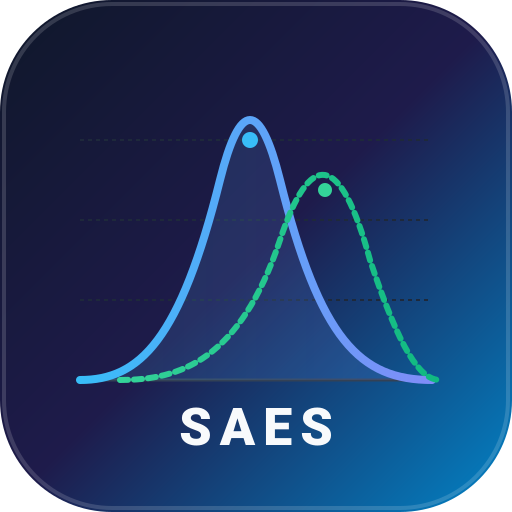

<p align="center">
  
</p>

<h1 align="center">SAES — Stochastic Algorithm Evaluation Suite</h1>

<p align="center">
  <a href="https://github.com/saes-suite/saes-bundle/actions/workflows/ci.yml"></a>
  <a href="https://pypi.org/project/saes/"></a>
  <a href="https://pypi.org/project/saes/"></a>
  <a href="https://github.com/saes-suite/saes-bundle/blob/main/LICENSE"></a>
  <a href="https://saes-suite.github.io/saes/"></a>
</p>

<p align="center">
  Rigorous frequentist, exact Bayesian, equivalence (TOST), sensitivity (MDES), and Dolan–Moré meta-benchmark evaluation — with interactive Web/Desktop UI, AI statistical consultant, and agentic skills.
</p>

<p align="center">
  <a href="https://saes-suite.github.io/saes/"><strong>📚 Documentation (GitHub Pages)</strong></a> ·
  <a href="saes/README.md"><strong>🐍 Core Library (<code>saes</code>)</strong></a> ·
  <a href="saes-ui/README.md"><strong>🖥️ Studio UI (<code>saes-ui</code>)</strong></a> ·
  <a href="saes-plugins/README.md"><strong>🧩 Agent Plugins</strong></a>
</p>

---

## Architecture

| Repository | Port | Role |
|---|---|---|
| [`saes/`](saes/README.md) | `:8060` | Core statistical Python library (`saes`), FastAPI REST server, and [GitHub Pages docs](https://saes-suite.github.io/saes/) |
| [`saes-ai/`](saes-ai/README.md) | `:8070` | Conversational AI assistant, multi-provider LLM connectors, and MCP server |
| [`saes-ui/`](saes-ui/README.md) | `:1420` | Thin-client React + TypeScript + Vite web frontend |
| [`saes-plugins/`](saes-plugins/README.md) | — | Claude Code plugin marketplace & cross-agent development skills for `saes` |
| `src-tauri/` + `packaging/` | — | Umbrella Tauri v2 desktop wrapper bundling `saes-ui` and the unified `saes-backend` PyInstaller sidecar |

---

## Quickstart

```bash
make install        # Install dependencies across saes, saes-ai, and saes-ui
make start          # Start all 3 services (saes :8060, saes-ai :8070, saes-ui :1420)
make start-desktop  # Start all 3 services with Tauri Desktop in dev mode
make start-docs     # Preview saes GitHub Pages documentation locally with live reload (:8000)
make docs-preview   # Build strict static GitHub Pages bundle and serve it locally (:8000)
make build-desktop  # Package saes-backend sidecar and build Tauri desktop installer
make ci             # Run lint, typecheck, tests, and cargo check across all 4 repos
```

---

## Docker Compose Deployment

Run the full web stack (`saes` from PyPI `saes[all]`, `saes-ai`, and `saes-ui`) using [docker-compose.yml](docker-compose.yml):

```bash
docker compose up -d --build
```

- **UI**: `http://localhost:1420`
- **saes API**: `http://localhost:8060`
- **saes-ai API**: `http://localhost:8070`
- **Shared datasets**: Persisted in the `saes_datasets` Docker volume (`/data/datasets` via `SAES_DATASETS_DIR`).
- **LLM providers**: Pass `OPENAI_API_KEY`, `ANTHROPIC_API_KEY`, or `GEMINI_API_KEY` in the environment (or `.env`), or connect to a host Ollama instance via `http://host.docker.internal:11434`.

---

## Desktop App Installation (macOS)

If macOS Gatekeeper blocks the downloaded `SAES.app` (e.g., *"SAES.app is damaged and can't be opened"* or *"cannot be opened because the developer cannot be verified"*), move `SAES.app` to `/Applications` and remove the quarantine attribute with:

```bash
xattr -cr /Applications/SAES.app
```
